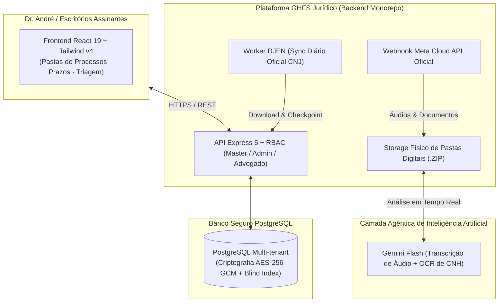

# GHFS Jurídico — Plataforma Agêntica SaaS

> **SaaS Jurídico de Alta Performance para Controladoria Processual (DJEN), Pastas Digitais e Triagem Oficial de WhatsApp com Inteligência Artificial.**

---

## 🏛️ Visão Geral da Arquitetura

O **GHFS Jurídico** é construído no formato **Monorepo Agêntico**, unificando backend com CQRS leve em TypeScript, banco relacional PostgreSQL sem ORM pesado, e frontend moderno com interface escura de alta ergonomia.

---

## 🚀 Módulos do Sistema

### 1. Controladoria Jurídica & Diário Oficial (DJEN / CNJ)
- **Sincronização Contínua e Resiliente:** Captura automática das intimações da OAB nacional diretamente da API oficial do CNJ.
- **Higienização de Texto:** Conversão automática de entidades HTML sujas para UTF-8 nítido.
- **Cálculo Determinístico de Prazos:** Estimativa de prazos em dias úteis com exclusão de finais de semana.
- **Certidões Prontas para Juntada:** Download individual em PDF oficial e **download em lote de todas as certidões do processo em arquivo `.ZIP`** com 1 clique.

### 2. Estação de Triagem WhatsApp Oficial (Meta Cloud API)
- **API Oficial da Meta (WABA):** Zero risco de banimento de chip; conexão estável via Webhook verificado com assinatura criptográfica `X-Hub-Signature-256`.
- **Dossiê Digital Automático:** Cada lead gera uma pasta do cliente estruturada no servidor.
- **Transcrição de Áudios por IA:** Áudios em formato `.ogg` enviados pelo cliente são transcritos para português com alta precisão via Gemini Flash.
- **Checklist Dinâmico por Área Jurídica:** Reconhecimento automático de documentos (CNH, RG, Comprovante de Residência, Contratos) adaptado para Direito Bancário (RCV), E-commerce (Mercado Livre), Cível, Tributário e Trabalhista.
- **Exportação da Pasta Digital (.ZIP):** Empacotamento instantâneo de todos os arquivos originais do cliente + relatório de resumo de fatos em `.txt`.

### 3. Multi-Tenancy & Segurança Bancária (Zero-Trust & LGPD)
- **Hierarquia de Acesso (RBAC):** Níveis `MASTER` (Gustavo — controle total de tenants), `ADMIN_DEV` (Alessandro) e `ADVOGADO` (André — isolado aos processos de sua OAB).
- **Criptografia Autenticada em Repouso (`AES-256-GCM`):** Mensagens, áudios, transcrições e dados pessoais gravados em binário cifrado (`BYTEA`) com Nonce de 96 bits exclusivo por linha.
- **Blind Index (`HMAC-SHA256`):** Busca instantânea de clientes por telefone sem necessidade de descriptografar a base.
- **Cadeia de Custódia Probatória:** Cálculo de hash `SHA-256` de todas as mídias recebidas no ato do download.
- **White-Label por Escritório:** Customização dinâmica do nome e da logo institucional do escritório assinante no topo do painel.

---

## 🛠️ Stack Tecnológica

- **Backend:** Node.js 20+, Express 5, TypeScript 5.9, `pg` (SQL puro parametrizado).
- **Frontend:** React 19, Vite 8, Tailwind CSS v4, Framer Motion, `@phosphor-icons/react`.
- **Inteligência Artificial:** Google Gemini Flash (`models/gemini-3.8-flash` / `gemini-2.5-flash-lite`).
- **Banco de Dados:** PostgreSQL 16+ com isolamento multi-tenant por schemas e triggers de proteção.

---

## 🔒 Licença e Direitos

Projeto proprietário e confidencial. Todos os direitos reservados a **Gustavo Simões (GHFS)**.
Uso restrito a escritórios e usuários licenciados.
