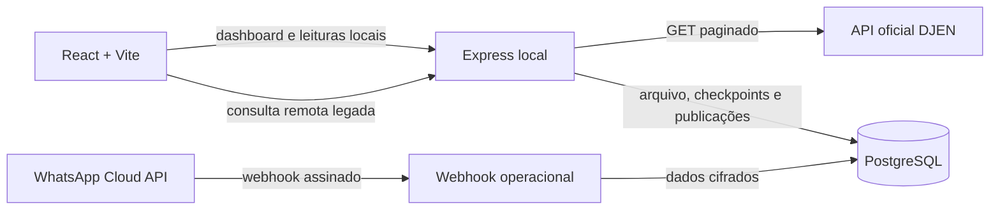

# DJEN Local

Backend local em Node.js/Express e PostgreSQL para consultar comunicações do Diário de Justiça Eletrônico Nacional (DJEN), arquivar respostas oficiais e relacionar publicações a processos. O repositório também inicia um módulo operacional de webhook WhatsApp, ainda sem download de mídia ou processamento de documentos.

## Visão geral



O módulo DJEN é usado pelo front em `D:\Projetos\consultas-andre`. O módulo operacional fica isolado no schema PostgreSQL `operacional` e não altera o contrato do front.

## Estrutura

```text
src/
  app.ts                         Monta rotas HTTP
  server.ts                      Inicializa serviços e servidor
  database.ts                    Pool PostgreSQL
  openapi.ts                     Contrato OpenAPI
  modules/
    djen/
      application/                Casos de uso DJEN e sincronização
        sync/                     Configuração e worker independente
      infrastructure/             Checkpoints e histórico de execuções
      worker.ts                    Composição do processo de sincronização
    operacional/                  Webhook e cifragem WhatsApp
database/migrations/              Migrações SQL sequenciais
```

  ## Responsabilidades das classes

  | Classe ou componente | Arquivo | Responsabilidade |
  |---|---|---|
  | `createApp` | `src/app.ts` | Configura middleware, Swagger e rotas HTTP; recebe controllers já construídos. |
  | Composição do servidor | `src/server.ts` | Carrega configurações e instancia pool, serviços, controllers e servidor Express. |
  | `DjenController` | `src/modules/djen/djen.controller.ts` | Converte requisições e respostas HTTP; delega a consulta e a alteração de status à porta `DjenServicePort`. |
  | `DjenService` | `src/modules/djen/djen.service.ts` | Fachada dos casos de uso DJEN; aplica filtros padrão e encaminha a leitura ou comando adequado. |
  | `DjenReadController` / `DjenReadService` | `src/modules/djen/djen-read.controller.ts` / `src/modules/djen/application/djen-read.service.ts` | Expõe dashboard e consultas locais de processos/publicações. |
  | `DjenReadRepository` | `src/modules/djen/infrastructure/djen-read.repository.ts` | Lê e agrega publicações persistidas por OAB, processo e status. |
  | `mapearPublicacao` | `src/modules/djen/application/publicacao.dto.ts` | Converte HTML, prepara texto de cópia e retorna os campos de estimativa. |
  | `ConsultarPublicacoesQueryHandler` | `src/modules/djen/application/consultar-publicacoes.query.ts` | Lê o advogado e procura uma resposta elegível no cache; não altera o estado persistido. |
  | `CapturarPaginaDjenCommandHandler` | `src/modules/djen/application/capturar-pagina-djen.command.ts` | Consulta a API oficial, arquiva os bytes e hashes da resposta e persiste publicações em transação. |
  | `AtualizarStatusCommandHandler` | `src/modules/djen/application/atualizar-status.command.ts` | Altera o status de leitura de uma intimação. |
  | `DjenSyncWorker` | `src/modules/djen/application/sync/djen-sync.worker.ts` | Prioriza consultas recentes, pagina cada janela e só avança o backfill depois de concluí-la. |
  | `DjenSyncRepository` | `src/modules/djen/infrastructure/djen-sync.repository.ts` | Mantém checkpoints, histórico de execuções e lock por OAB/UF no PostgreSQL. |
  | Entry point do worker | `src/modules/djen/worker.ts` | Compõe dependências e executa o ciclo contínuo ou uma única vez, fora do servidor HTTP. |
  | `WhatsAppWebhookController` | `src/modules/operacional/whatsapp.controller.ts` | Atende handshake da Meta, valida a assinatura do corpo bruto e traduz o resultado para HTTP. |
  | `WhatsAppWebhookService` | `src/modules/operacional/whatsapp.service.ts` | Interpreta eventos, cifra dados sensíveis e persiste evento, contatos, mensagens e referências de mídia. Não baixa arquivos. |
  | Funções criptográficas | `src/modules/operacional/whatsapp.crypto.ts` | Valida chaves, cifra/decifra dados, calcula HMAC de telefone e valida assinatura da Meta. |

  `djen.entity.ts` e `djen.module.ts` estão vazios e não representam entidades ou módulos ativos neste momento.

  ## CQRS e avaliação de Clean Code

  O módulo DJEN usa **CQRS leve, dentro do próprio módulo**: a query lê advogado/cache e os commands capturam/persistem uma página ou atualizam status. A fachada e as rotas públicas permanecem; a resposta da API oficial continua sendo devolvida sem remodelagem. Queries e commands usam o mesmo PostgreSQL e as gravações de uma captura continuam transacionais.

  Não foram adicionados barramento, eventos, event sourcing, banco de leitura separado nem consistência eventual. Para este backend Express, isso preserva a separação que ajuda a compreender os casos de uso sem introduzir infraestrutura que o volume e o domínio atuais não justificam. A separação é organizacional: não implica que leitura e escrita estejam em modelos ou bancos físicos diferentes.

  **O que melhorou:** controllers dependem de portas em vez de detalhes de banco; a fachada DJEN coordena casos de uso; consultas e mutações têm nomes e entradas explícitos; transações preservam o arquivamento e a persistência de cada captura.

  **O que ainda não está plenamente alinhado a Clean Code:**

  - `CapturarPaginaDjenCommandHandler` ainda reúne chamada HTTP, arquivamento, validação e persistência SQL; é o próximo candidato a extração de gateway e repositório, se a lógica continuar crescendo.
  - `ConsultarPublicacoesQueryHandler` e `AtualizarStatusCommandHandler` dependem diretamente de `Pool`, e `DjenService` importa o pool global. Isso limita testes unitários isolados; uma porta de repositório injetada só deve ser criada quando houver testes de aplicação ou mais de um adaptador real.
  - `WhatsAppWebhookService` ainda combina parsing do payload, decisão de cliente e gravação transacional. Não foi dividido nesta refatoração para manter o escopo no módulo DJEN.
  - O status recebido no PATCH é validado como texto, mas ainda não é restrito a um conjunto permitido; erros dos controllers ainda usam `any` em alguns pontos.

  Portanto, CQRS leve foi aplicado, mas não significa que todas as classes estejam pequenas ou que todos os princípios de Clean Code estejam atendidos. A evolução recomendada é extrair persistência DJEN para um repositório transacional e cobri-lo com testes de integração PostgreSQL antes de adicionar novos padrões.

## Requisitos

- Node.js 20 ou superior
- PostgreSQL local
- `npm install`
- Para o front, um projeto Vite separado apontando para `http://localhost:3000`

## Configuração local

No PowerShell, na raiz do repositório:

```powershell
Copy-Item .env.example .env
```

Configure `DATABASE_URL` ou os campos `DB_HOST`, `DB_PORT`, `DB_USER`, `DB_PASSWORD` e `DB_NAME`. Para testar o webhook da Meta, configure `WHATSAPP_VERIFY_TOKEN`, `WHATSAPP_APP_SECRET`, `WHATSAPP_DATA_ENCRYPTION_KEY` e `WHATSAPP_PHONE_HASH_KEY`. As duas chaves criptográficas devem ser valores hexadecimais independentes de 32 bytes; guarde-as fora do Git e mantenha cópia segura para recuperação dos dados.

`WHATSAPP_TOKEN`, `WHATSAPP_PHONE_NUMBER_ID` e `WHATSAPP_STORAGE_PATH` estão reservados para as próximas etapas de download de mídia. Ainda não são usados pelo código.

## Banco de dados

As migrações são aditivas e devem ser aplicadas uma única vez, em ordem, ao banco configurado:

```powershell
psql "$env:DATABASE_URL" -v ON_ERROR_STOP=1 -f database/migrations/001_djen_auditoria.sql
psql "$env:DATABASE_URL" -v ON_ERROR_STOP=1 -f database/migrations/002_djen_deduplicacao.sql
psql "$env:DATABASE_URL" -v ON_ERROR_STOP=1 -f database/migrations/003_operacional_whatsapp.sql
psql "$env:DATABASE_URL" -v ON_ERROR_STOP=1 -f database/migrations/004_djen_sincronizacao.sql
```

`001` cria o arquivo imutável das respostas DJEN, com corpo original e SHA-256. `002` cria as chaves de deduplicação e a origem canônica das publicações. `003` cria tabelas isoladas para clientes, mensagens, documentos e eventos WhatsApp. `004` registra checkpoints e execuções do worker DJEN.

O schema operacional cifra mensagens, telefones, nomes e payloads. A migração cria a estrutura, mas **não implementa ainda** download de arquivos, antivírus/quarentena efetiva, OCR, transcrição, classificação, qualificação de cliente ou endpoints para o painel.

## Executar

```powershell
npx tsx src/server.ts
```

O backend atende em `http://localhost:3000` por padrão. A interface Swagger fica em [`http://localhost:3000/api-docs`](http://localhost:3000/api-docs), e o documento OpenAPI em `http://localhost:3000/openapi.json`.

## Rotas atuais

| Método | Rota | Função |
|---|---|---|
| `GET` | `/api/v1/comunicacao` | Encaminha filtros/paginação ao DJEN, persiste a resposta e devolve o JSON oficial. |
| `GET` | `/api/v1/publicacoes/dashboard` | Contagens por OAB/UF e dez publicações recentes do banco local. |
| `GET` | `/api/v1/publicacoes` | Lista publicações locais, filtráveis por status, tribunal e disponibilização. |
| `GET` | `/api/v1/processos` | Lista processos agrupados para uma OAB/UF, com quantidade e publicação mais recente. |
| `GET` | `/api/v1/processos/:id/publicacoes` | Lista publicações do processo por ID, paginadas. |
| `PATCH` | `/api/v1/publicacoes/:id/status` | Atualiza status de leitura usando a nomenclatura Publicação. |
| `GET` | `/api/v1/tribunais` | Lista homepages mapeadas para tribunais superiores, TJs e TRFs. |
| `PATCH` | `/api/djen/intimacoes/:id/status` | Atualiza status de leitura. |
| `GET` | `/webhook/whatsapp` | Verificação do webhook pela Meta via `hub.verify_token`. |
| `POST` | `/webhook/whatsapp` | Valida `x-hub-signature-256` e persiste mensagens recebidas. Limite atual: 3 MB. |

As rotas novas consultam somente o banco local e aceitam `numeroOab`/`ufOab` (padrão `69161/PR`). Listagens aceitam `pagina` (padrão 1) e `itensPorPagina` (padrão 25, máximo 100). `GET /api/v1/publicacoes` também aceita `status`, `tribunal`, `dataInicio` e `dataFim`. IDs de processo são UUIDs.

O DTO de publicação traz `texto` em plain text, `partes`, datas, `linkInteiroTeor`, `hash`, `homepageTribunal`, `textoParaCopiar` e `estimativaPrazoFinal`. O texto de cópia inclui partes, exceto para `Intimação`. O `hash` continua sendo usado pelo botão existente de certidão; este backend não adiciona proxy ou rota nova para o arquivo.

Exemplos para integração do front:

```text
GET /api/v1/publicacoes/dashboard?numeroOab=69161&ufOab=PR
GET /api/v1/processos?numeroOab=69161&ufOab=PR&pagina=1&itensPorPagina=25
GET /api/v1/processos/{id}/publicacoes?pagina=1&itensPorPagina=25
GET /api/v1/publicacoes?status=PENDENTE&tribunal=TJPR
```

Exemplo de consulta:

```powershell
Invoke-RestMethod "http://localhost:3000/api/v1/comunicacao?numeroOab=69161&ufOab=PR&pagina=1&itensPorPagina=100"
```

O campo `count` do DJEN conta comunicações, não processos únicos. Cada `items[]` é uma publicação/comunicação; várias podem pertencer ao mesmo número CNJ.

### Sincronização independente do front

O worker roda em processo separado e reutiliza o mesmo handler de captura/auditoria. A cada ciclo, consulta primeiro os últimos dias e depois avança o backfill histórico em janelas diárias; cada requisição pede até 100 itens e percorre todas as páginas antes de avançar o checkpoint. O lock consultivo do PostgreSQL evita duas instâncias simultâneas para a mesma OAB/UF. O `GET /api/v1/comunicacao` e seu contrato permanecem inalterados.

Defina `DJEN_SYNC_DATA_INICIO_BACKFILL` no `.env` com a data inicial desejada (`YYYY-MM-DD`) antes de iniciar o worker. Essa configuração é obrigatória para evitar uma carga histórica acidental e só inicializa o checkpoint na primeira execução; depois disso, o banco guarda o progresso. `DJEN_SYNC_NUMERO_OAB` e `DJEN_SYNC_UF_OAB` selecionam uma OAB por processo; as demais opções ajustam lookback, dias de backfill por ciclo e intervalo entre ciclos.

```powershell
npm run djen:sync
```

O comando acima mantém o worker ativo. Para executá-lo uma vez por uma agenda externa, use `npm run djen:sync:once` (por exemplo, no Agendador de Tarefas do Windows). A migration `004` deve ser aplicada antes. O worker registra cada janela e retoma um dia de backfill incompleto no próximo ciclo; não o inicie até definir a data inicial e validar a cadência adequada para a API do DJEN.

### Webhook WhatsApp

O handshake GET e a validação da assinatura POST estão implementados. O POST exige o App Secret da Meta e só aceita uma assinatura HMAC-SHA256 válida sobre os bytes originais do corpo. Eventos e mensagens são deduplicados, e o conteúdo sensível é cifrado antes da gravação.

Para receber chamadas reais, a Meta precisa alcançar um endpoint HTTPS público. Não exponha a porta local diretamente; use ambiente de teste/túnel controlado ou um host com TLS. Não conecte o número operacional até validar o fluxo com número de teste e confirmar impactos com a Meta.

## Persistência DJEN

- `processos`: uma linha por número CNJ.
- `intimacoes`: uma linha por ID externo da comunicação DJEN.
- `djen_respostas`: corpo binário original, URL, parâmetros, status, data e hash.
- `djen_resposta_chaves`: deduplicação por URL, status HTTP e hash da resposta.
- `djen_intimacao_origens`: primeira resposta em que cada publicação foi observada.

O nome físico `intimacoes` permanece por compatibilidade com o schema existente; as novas rotas e DTOs usam a nomenclatura `publicacoes`. Quando a API oficial não informa `data_publicacao`, a captura preenche o campo com o próximo dia útil após a disponibilização, pulando fins de semana e sem calendário de feriados.

Consultas históricas fechadas são cacheadas sem expiração; consultas correntes usam cache de 15 minutos. O front segue solicitando páginas. Portanto, uma página consultada não garante que todo o histórico de um advogado/processo foi importado.

## Testes e typecheck

```powershell
npm test
npx tsc --noEmit --verbatimModuleSyntax false
```

Os testes atuais cobrem os contratos HTTP locais e remotos, DTOs de publicação, texto para cópia, contagem de dias úteis, paginação do worker, cache, hash e webhook. Eles **não** fazem integração real com Meta/DJEN/PostgreSQL.

O comando padrão `npx tsc --noEmit` ainda conflita com a configuração atual: `package.json` declara CommonJS, enquanto `tsconfig.json` usa `NodeNext` com `verbatimModuleSyntax`. O comando acima contorna esse conflito só durante a validação; a configuração ainda precisa ser alinhada.

## Limitações conhecidas antes de uso real

- A tabela `operacional.documentos` ainda não tem a coluna `media_kind` usada pelo INSERT do serviço. O primeiro webhook que trouxer mídia falhará até a migração e o código serem alinhados.
- O webhook atual armazena IDs de mídia, mas não baixa os binários nem implementa verificação de tipo, tamanho ou quarentena.
- O endpoint legado `/api/v1/comunicacao` preserva o HTML oficial; o front deve usar as novas rotas locais para receber `texto` convertido em plain text.
- CORS está aberto, o servidor não força bind em `127.0.0.1`, e o PATCH não tem autenticação. O estado atual é apenas para desenvolvimento local controlado, não para exposição em rede/produção.
- A estimativa calcula somente prazos expressos em dias úteis no texto, usando `dataPublicacao` como base e pulando fins de semana, sem feriados. Sem prazo explícito, retorna `REGRA_LEGAL_PENDENTE` e `dataFinal: null`; ainda faltam as regras aprovadas do Código Civil e das leis específicas. Nenhuma estimativa deve ser tratada como prazo confirmado.

## Próximas etapas sugeridas

1. Corrigir o contrato `media_kind` e adicionar testes de repositório/transação.
2. Implementar uma caixa de entrada durável para webhooks e download seguro dos anexos.
3. Criar storage local cifrado com nomes aleatórios, limites, allowlist de tipos e quarentena.
4. Acrescentar OCR/transcrição local e revisão humana.
5. Criar API/tela operacional com autenticação e autorização por cliente.
6. Alinhar com o advogado o catálogo de regras legais para preencher estimativas sem prazo explícito.